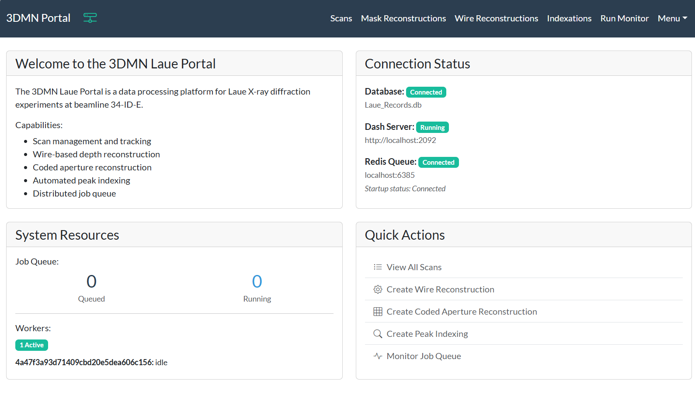

# Laue Portal

A Dash interface for managing Laue diffraction scans, wire reconstruction,
indexing, and visualization at APS beamline 34-ID-E.



## Setup

Use Python 3.12. Building the pinned lauelab dependency requires a C compiler
with OpenMP, CMake >= 3.24, GSL 2.8, HDF5 1.14, zlib, Ninja, and patchelf.
The [CI configuration](.github/workflows/python-tests.yml) shows the conda-forge
build environment. Redis is required for local processing.

```bash
git clone https://github.com/Linked-Liszt/laue-portal.git
cd laue-portal
python -m pip install -r requirements.txt
cp config.yaml.template config.yaml
```

Edit `config.yaml`: set `db_file`, the experiment root and output paths,
`REDIS_CONFIG`, and `DASH_CONFIG`. Use `LAUE_PORTAL_CONFIG` to select an external
configuration file. Keep `DASH_CONFIG.debug: false` for deployed servers.

```bash
python lau_dash.py
```

Local processing also needs an RQ worker. [Supervisor](supervisor/README.md)
manages the web server, Redis, and worker. Optional DM/Globus execution and its
separate deployment requirements are described in [deploy/README.md](deploy/README.md).

## Live processing

The **Live** page starts one APS session. Enable **Reconstruction**, **Indexing**,
or both: indexing alone processes raw detector frames; both stages reconstruct
stacks and index their depths. Only enabled stages get ordinary R/I records and
viewers. One local RQ controller holds the worker until Stop; ordinary local
batch jobs wait in that queue. The shared 24-core budget uses three reconstruction
workers with eight threads each, 24 persistent raw-indexing workers, or two
reconstruction workers with eight threads each plus eight indexing workers.

Live reconstruction requires lauelab's `PreparedScan.add`, `outcomes`, `export_state`,
and `restore` APIs, included in the pinned dependency. Keep portal and worker
environments on the same reviewed library revision.

For DM acquisition, enable `LIVE.dm` in the private configuration using the
existing DM setup/login file. Select a running **Input source** DAQ and an
**Input folder** inside its displayed destination. The controller reads completed
catalog entries in bounded pages, verifies acquisition/path/size, and admits
matching inputs through the existing ledger. One background thread keeps API
delays away from processing. Its saved cursor, overlapping queries and periodic
reconciliation support recovery and late catalog insertion. Catalog/API problems
appear on the Live header and retry without failing healthy scientific work.
The source must publish closed frames/stacks: cataloging confirms a successful
copy, rather than detector completion. The simulator below supplies this contract.
No per-file workflow is submitted. Start/Stop never starts or stops the DAQ.
Files already cataloged in the selected folder are included; use a fresh scan
folder for each replay. `LIVE.defaults` may prefill `daq_id`, `scan_number`,
`input_path`, `filename`, `output_path`, `geometry_file`, `crystal_file`,
`reconstruction_enabled`, and `indexing_enabled`.
An optional `indexing` mapping overrides canonical indexing parameter defaults
for Live without changing ordinary batch forms.

Without DM, ready inputs enter through a short notification command in the
configured portal environment:

```bash
python -m laue_portal.processing.live_cli notify SESSION_ID /data/point_1.h5 --complete
python -m laue_portal.processing.live_cli status SESSION_ID
```

`--complete` asserts that the acquisition/transfer system has finished the whole
frame or stack and will not modify it. Connect this command to a DM completion hook;
file existence or a quiet timer is insufficient. The controller does not infer
readiness by watching a detector directory. A rehearsal can replay already closed
files with `replay SESSION_ID --points 1-2 --interval 51 --closed-inputs`.

To exercise actual DM transfer, `scripts/replay_detector.py --source /staged/raw
--destination /detector/fresh_scan --filename 'scan_%d.h5' --fps 10 --count 300`
copies files at the requested rate, closes them before atomic publication, and
refuses to overwrite existing destination files. Configure a dedicated DM DAQ
over the detector directory separately. The simulator never notifies the portal;
the normal transfer/catalog path supplies readiness. Keep immutable sources
outside the watched detector directory. Temporary writes default to the source
parent; `--temporary-directory` can select another directory on the destination
filesystem, outside the entire DAQ watch tree. This avoids relying on watcher
rename events, which some DM/watchdog combinations miss.

Live acquisition is open-ended: every matching completed-input notification is
accepted, without an expected point range. **Stop** seals arrivals, drains all
accepted reconstruction and indexing work, and publishes final results. Points
that never arrived do not cause a failure; processing errors still do. An empty
run stops as Cancelled without an error. An empty queue while acquisition remains
open means waiting for data. Saved point selections and job counts follow actual
arrivals, including gaps in point numbering.
The R/I viewers refresh publication revisions and preserve existing selections;
the reconstruction viewer can optionally follow the newest completed point.

The SSD portal database stores the active-session reservation, arrivals,
checkpoint, point tasks, and recorded outcomes. Frozen calibration copies, an
OS-owned writer lock, and fsynced worker receipts are stored under `live/` beside
the database. Scientific point files and indexing shards remain under each new
R/I output directory. Existing data and published point files are not replaced.
Indexing previews are merged through lauelab's public APIs; publication coalesces
updates and reduces its frequency if stitching becomes expensive.
Raw indexing closes small result batches, extends a validated preview by atomic
replacement, and stitches auxiliary XML at Stop. It does not create a worker
pool or result shard for every arriving frame.
Existing live databases need the [workflow database migration](deploy/README.md#database-and-authorization)
to make reconstruction references optional before enabling indexing-only sessions.

After an orderly worker shutdown, use **Resume** to replay saved receipts and
continue. Uncertain dispatched tasks without a receipt, orphan outputs, and
partial files require operator reconciliation; they are preserved and never
silently retried. **Stop** can abandon an interrupted session while retaining its
files. Browser disconnects do not stop the controller. Real DM readiness wiring
must be verified separately from the closed-input rehearsal.

## Code layout

- `laue_portal/pages/` and `components/`: Dash pages and forms.
- `laue_portal/workflows/`: requests, manifests, run records, and lifecycle.
- `laue_portal/processing/`: local workers, compute adapters, and remote runners.
- `laue_portal/processing/bdp/`: DM, Globus, PBS, and returned-result publication.
- `deploy/`: remote runtime requirements, deployment templates, and endpoint tools.
- `supervisor/`: service configuration and management scripts.

## Tests

```bash
python -m pytest tests/
# Include optional workflow tests, as CI does:
python -m pip install -r deploy/requirements-workflows.txt
python -m pytest tests/ workflow_tests/
ruff check .
ruff format --check .
```

The workflow tests use fixtures and mocks without contacting live DM/Globus
services or submitting PBS jobs. Runtime configuration, credentials, databases,
and generated state stay outside Git.
